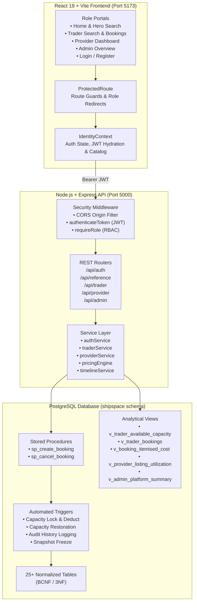

# ShipSpace — LCL Shipping Capacity Marketplace

**Space for every shipment.**  
A database-centred, production-grade full-stack **Less-than-Container-Load (LCL)** ocean freight capacity marketplace built with **PostgreSQL**, **Node.js + Express**, and **React + Vite**.


---

## 1. Overview & Problem Statement

In global ocean logistics, small and medium enterprises (**Traders / Shippers**) frequently need to transport partial container loads (for example, **3 to 8 CBM** and **1 to 4 tonnes**). Booking a full container (**FCL**) for partial loads is cost-prohibitive, while **Logistics Providers** (freight consolidators and NVOCCs) regularly sail container vessels with underutilised capacity.

**ShipSpace** solves this imbalance through a relational database-enforced LCL marketplace:
- **Logistics Providers** publish available container volume (**CBM**) and payload (**tonnes**) on directed maritime routes with explicit CFS cut-off dates, sailing schedules, permitted cargo classifications, and itemised freight tariffs.
- **Traders** search global trade lanes with multi-constraint filters (origin, destination, CBM, weight, cargo readiness), inspect itemised all-in cost quotes, reserve capacity under atomic row locks, upload required export documents, and track shipment milestones.
- **Platform Administrators** govern the master reference catalog (Seaports, UN/LOCODEs, Maritime Routes, Cargo Types, Standard Charges, Milestone Types), manage user accounts, and inspect platform-wide audit logs and capacity utilization in real time.

---

## 2. Key Features

### Core Marketplace & Concurrency Engine
- **Atomic Space Reservation:** Enforces concurrency serialization via PostgreSQL row-level locks (`SELECT ... FOR UPDATE` on `capacity_listing`). Two concurrent bookings competing for remaining space cannot overcommit capacity.
- **Automatic Capacity Restoration:** Cancelling a confirmed booking immediately restores the reserved CBM and weight back to the listing and reopens the listing status from `full` to `open`.
- **Full Historical Audit Trail:** Every status change is captured in `booking_status_history` via database triggers, recording timestamp, user ID, old/new statuses, and rationale.

### Feature A: Itemised All-In Cost Pricing Engine (`sql/09_feature_a_all_in_cost.sql`)
- **13 Standard Charge Types:** Categorised across Origin (`O`), Ocean Freight (`F`), Destination (`D`), and Storage (`S`) stages.
- **Flexible Charge Bases:** Supports `per_cbm`, `per_tonne`, `per_w_m` (w/m revenue tonne), `flat_fee`, and `percentage`.
- **Frozen Financial Snapshots:** When a booking is confirmed, itemised charge calculations are frozen into immutable `booking_charge_snapshot` rows. Subsequent price edits by the provider never alter historical bookings.
- **Analytical View:** `v_booking_itemised_cost` aggregates origin charges, freight charges, destination fees, storage, and prepaid/collect splits without `1:M` join duplication.

### Feature B: Shipment Timelines, Documents & Rollover Management (`sql/10_feature_b_timelines_docs_rollover.sql`)
- **Configurable Milestone Timelines:** 7 standard milestone types seeded (`booking_confirmed`, `cfs_cargo_received`, `customs_cleared`, `vessel_departed`, `vessel_arrived`, `customs_destination_cleared`, `cargo_delivered`).
- **Export Document Checklist:** Initialises standard document requirements (`commercial_invoice`, `packing_list`, `shipping_bill`, `bill_of_lading`, etc.) with secure private filesystem storage outside the web root (`backend/private_uploads/`).
- **Provider Rollover Management:** When cargo misses cut-off, providers can record decisions (`accept`, `roll`, `cancel`) with reason logging, fee adjustments, and automated capacity transfers to next sailings.
- **In-App Notifications & Reminders:** Automated reminder generation for upcoming cut-off dates and document requirements with read tracking.

### Phase 1: Secure Authentication & Authorization
- **Database Credential Verification:** `POST /api/auth/login` verifies real credentials against PostgreSQL `user_account` with `bcryptjs` (salt rounds = 10).
- **Gradual Hash Migration:** Automatically and safely upgrades legacy SHA-256 and demo password hashes to bcrypt upon valid login without locking out accounts.
- **JWT Authorization:** Issues cryptographically signed JSON Web Tokens containing verified identity and role.
- **Fail-Safe Secrets:** Rejects missing or known development placeholder secrets with a fatal error in production mode (`NODE_ENV=production`).
- **Role-Based Access Control (RBAC):** Server-side verification strictly limits admin, provider, and trader endpoints.
- **Record Ownership Enforcement:** Prevents cross-trader booking tampering and cross-provider listing modifications (`403 FORBIDDEN_OWNERSHIP`).
- **Frontend Route Guards:** React Router guards (`<ProtectedRoute>`) protect private dashboards and redirect unauthenticated users to `/login?redirect=...`.
- **Production-Restricted CORS:** Configurable origin allowlisting via `CORS_ORIGIN` that fails closed against untrusted domains.

---

## 3. Technology Stack

| Layer | Technologies |
| :--- | :--- |
| **Database** | PostgreSQL 14+ (BCNF normalized schema, Stored Procedures, Triggers, Views, Partial Indexes, Row Locking) |
| **Backend Runtime** | Node.js (v18+) & Express 5 |
| **Authentication & Security** | JSON Web Tokens (`jsonwebtoken`), `bcryptjs`, CORS middleware |
| **Database Driver** | `pg` (Connection Pooling + Parameterized Queries + Transactions) |
| **Frontend Framework** | React 19, Vite 6, React Router DOM 7 |
| **UI & Styling** | Custom ShipSpace Navy-and-Orange CSS Design System, Lucide React Icons |
| **Testing** | Node.js Native Test Runner (`node --test`), `assert/strict` |

---

## 4. System Architecture



---

## 5. Database Engineering & Migration Sequence

All database logic, constraints, procedures, and tables are defined in sequential SQL files under [`sql/`](file:///c:/Users/Harshita/Documents/smartLCL/sql).

### Required Execution Order

To set up a fresh database, execute the SQL files in this exact sequence:

```bash
# Set your target database connection
export PGDATABASE="shipspace_test_phase5"
export PGUSER="postgres"

# 1. Base Schema (14 Normalized Core Tables)
psql -v ON_ERROR_STOP=1 -f sql/01_schema.sql

# 2. Seed Data (Ports, Routes, Accounts, Listings)
psql -v ON_ERROR_STOP=1 -f sql/02_seed_data.sql

# 3. Core Operational & Analytical Views
psql -v ON_ERROR_STOP=1 -f sql/03_views.sql

# 4. Indexes (B-Tree Composite & Partial Indexes)
psql -v ON_ERROR_STOP=1 -f sql/04_indexes.sql

# 5. Functions & Triggers (sp_create_booking, sp_cancel_booking, capacity triggers)
psql -v ON_ERROR_STOP=1 -f sql/05_functions_triggers.sql

# 6. Feature A: Itemised All-In Cost Pricing Engine
psql -v ON_ERROR_STOP=1 -f sql/09_feature_a_all_in_cost.sql

# 7. Feature B: Timelines, Document Checklists & Rollover Management
psql -v ON_ERROR_STOP=1 -f sql/10_feature_b_timelines_docs_rollover.sql
```

> **Note on Safety:** Never run `sql/00_reset.sql` against an existing production or evaluation database containing live bookings.

---

## 6. Environment Configuration

### Backend Configuration (`backend/.env`)

Copy `backend/.env.example` to `backend/.env`:

```bash
cp backend/.env.example backend/.env
```

Configure the following variables in `backend/.env`:

```env
# Server Port
PORT=5000

# PostgreSQL Connection
DB_HOST=localhost
DB_PORT=5432
DB_NAME=shipspace_test_phase5
DB_USER=your_postgres_username
DB_PASSWORD=your_postgres_password

# JWT Authentication
JWT_SECRET=your_secure_random_jwt_secret_min_32_characters
JWT_EXPIRES_IN=24h

# Allowed CORS Origins (comma-separated for production)
CORS_ORIGIN=http://localhost:5173
```

### Frontend Configuration (`frontend/.env`)

Copy `frontend/.env.example` to `frontend/.env`:

```bash
cp frontend/.env.example frontend/.env
```

```env
# Backend API Base URL
VITE_API_BASE_URL=http://localhost:5000/api
```

---

## 7. Installation & Running

### Prerequisites
- **Node.js 18+** (Node 20+ or 24 recommended)
- **npm** (v9+)
- **PostgreSQL 14+**

### 1. Start the Backend API Server

```bash
cd backend
npm install
npm run dev      # or: npm start
```
The server will start on `http://localhost:5000`. You can verify connectivity at `http://localhost:5000/api/health/db`.

### 2. Start the Frontend Application

In a separate terminal:

```bash
cd frontend
npm install
npm run dev
```
Open **`http://localhost:5173`** in your browser.

### 3. Production Frontend Build

To verify compilation and generate production assets:

```bash
cd frontend
npm run build
```

### 4. Running with Docker Compose

ShipSpace includes a multi-container Docker Compose orchestration for the PostgreSQL database, Node.js/Express backend, and Nginx-served React frontend:

```bash
# 1. (Optional) Customize environment variables
cp .env.example .env

# 2. Build and start all services
docker compose up -d --build

# 3. Verify service health and container status
docker compose ps
docker compose logs -f

# 4. Stop containers and preserve volumes
docker compose down
```

Services exposed when running via Docker Compose:
- **Frontend (Nginx / SPA):** `http://localhost:5173`
- **Backend API:** `http://localhost:5000` (health check at `/api/health`)
- **PostgreSQL Database:** `localhost:5432` (persistent data stored in `postgres_data` volume)

---

## 8. Automated Test Suite

ShipSpace includes a comprehensive automated test suite covering pricing calculations, capacity snapshot freezes, concurrent listing statuses, JWT authentication, role-based access, and cross-user ownership isolation.

To run all backend tests:

```bash
cd backend
npm test
```

### Test Coverage Summary (36/36 Passing):
- **Authentication & Security (`tests/auth.test.js`):**
  - Valid demo login & bcrypt hash upgrade
  - Invalid password & validation rejection
  - Missing credentials & short password rejection
  - Unauthenticated admin rejection (`401`)
  - Invalid Bearer token rejection (`401`)
  - Role-based authorization violations (`403 FORBIDDEN_ROLE`)
  - Cross-user listing tampering rejection (`403 FORBIDDEN_OWNERSHIP`)
  - Authenticated admin summary access
  - Verified user profile lookup (`/api/auth/me`)
  - Production `JWT_SECRET` fail-safe validation
  - Cross-trader timeline access rejection (`403`)
  - Cross-user notifications access rejection (`403`)
  - Cross-provider rollover and booking inspection rejection (`403`)
- **Booking Charge Snapshots (`tests/feature_a_booking_snapshots.test.js`):**
  - Atomic charge snapshot creation & view verification
  - Legacy listing backward compatibility
  - Transaction rollback on snapshot failure
  - Protection against post-booking price alterations
  - Capacity restoration on cancellation with snapshot preservation
- **Pricing Engine & Quotes (`tests/feature_a_pricing_engine.test.js`):**
  - Minimum charge behavior & tariff rounding
  - W/M, CBM, weight, and flat fee pricing calculations
  - Negative and invalid input rejection
  - 13 standard charge types catalog verification
  - Provider pricing rules persistence
- **Listing Status & Concurrency (`tests/phase2a_listing_status.test.js`):**
  - Reopen validation for zero-weight and zero-CBM listings
  - Past cutoff reopen rejection
  - Concurrent status updates under row locks
  - UI action button state verification

---

## 9. Demo Accounts & Seed Credentials

For quick evaluation during demonstrations, seeded test accounts are configured with known demo passwords:

| Role | Company / Name | Login Email | Demo Password | Default Dashboard |
| :--- | :--- | :--- | :--- | :--- |
| **Trader** | Aarav Textiles Ltd | `shipping@aaravtextiles.in` | `demopass123` | `/bookings` |
| **Trader** | Bharat Automotive Exports | `logistics@bharatauto.com` | `demopass123` | `/bookings` |
| **Provider** | Maersk LCL Consolidators | `ops.india@maersk-lcl.com` | `demopass123` | `/provider` |
| **Provider** | MSC Ocean Freight Direct | `msc.lcl@msc.com` | `demopass123` | `/provider` |
| **Admin** | ShipSpace Governance Admin | `superadmin@shipspace.internal` | `demopass123` | `/admin` |

*Note: On first login, each legacy seeded password hash is automatically upgraded in PostgreSQL to bcrypt with 10 salt rounds.*

---

## 10. Demo Walkthrough & Key Workflows

1. **Marketplace Capacity Search (`/search`):**
   - Filter listings by origin, destination, CBM, weight, and cargo type.
   - Live tariff comparison between lowest price and earliest departure.
2. **Itemised All-In Cost Quote (`/search` → "Get Quote"):**
   - View transparent itemised breakdown across origin CFS fees, ocean freight, destination terminal handling, and documentation.
   - Payer split shows exact prepaid shipper fees vs. collect consignee charges.
3. **Trader Booking & Milestone Timeline (`/bookings`):**
   - Confirm bookings under transactional locks.
   - Track live vertical milestone timeline (`booking_confirmed` → `cfs_cargo_received` → `customs_cleared` → `vessel_departed` → `cargo_delivered`).
   - Upload export documents (Commercial Invoice, Packing List, Shipping Bill) stored securely in `backend/private_uploads/`.
4. **Provider Schedule & Rollover Management (`/provider`):**
   - Manage vessel cut-off dates, CFS gate-in deadlines, and rollover policies (`flexible_rollover`, `strict_cutoff`, `fee_based_rollover`).
   - If cargo misses cut-off, record operator decisions (`accept`, `roll`, `cancel`) and seamlessly re-allocate space.
5. **Admin Governance & Capacity Analytics (`/admin`):**
   - Inspect platform KPIs, route-level utilization heatmaps, global booking status audit trails, and reference entity catalogs.

---

## 11. Security & Compliance Notes

- **Secrets Management:** `.env` and `backend/.env` files are ignored by Git. Never commit production credentials.
- **Private Uploads:** Uploaded commercial documents are stored outside the web root (`backend/private_uploads/`) and are accessible only to verified booking owners and administrators.
- **Database Backups:** Local `.dump` and `.backup` files are excluded by `.gitignore`.

---

## 12. License

ISC License. Built for enterprise LCL maritime freight logistics demonstrations.
