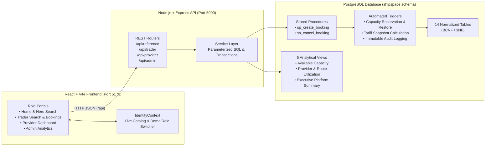

# ShipSpace — LCL Shipping Capacity Marketplace

**Space for every shipment.**  
A database-centred full-stack **Less-than-Container-Load (LCL)** ocean freight capacity marketplace built with **PostgreSQL**, **Node.js + Express**, and **React + Vite**.


---

## 1. Overview & Problem Statement

In international maritime logistics, small and medium-sized exporters (**Traders**) frequently need to ship cargo volumes smaller than a full 20-foot or 40-foot shipping container (for example, **3 to 8 CBM** and **1 to 4 tonnes**). Chartering a full container (**FCL**) for partial loads is cost-prohibitive, while **Logistics Providers** (freight consolidators and NVOCCs) regularly sail containers with unutilized space.

**ShipSpace** solves this problem through a relational database-enforced LCL marketplace:
- **Logistics Providers** publish spare container volume (**CBM**) and payload (**tonnes**) on directed port-to-port maritime routes with explicit booking cutoff dates, departure/arrival schedules, permitted cargo classifications, and tariff rates.
- **Traders** search across global trade lanes, compare live vessel capacity and automatically computed freight quotes, reserve space under row-level concurrency locks, and track or cancel bookings with full capacity restoration.
- **Administrators** maintain the master reference catalog (Seaports, Maritime Routes, Cargo Classifications) and monitor route-level and provider-level utilization and booking audit trails in real time.

---

## 2. System Architecture



---

## 3. Database Engineering Highlights (DBMS Core)

Unlike basic CRUD applications that enforce business rules only in frontend or middleware code, **ShipSpace enforces all core invariants inside PostgreSQL**:

### 3.1 14-Table Normalized Relational Schema (`sql/01_schema.sql`)
- **Supertype / Subtype Account Hierarchy:** `user_account` serves as the master identity table, with role-constrained subtype tables `provider`, `trader`, and `admin` linked via composite foreign keys `(id, role) REFERENCES user_account(id, role)`.
- **Reference & Governance Tables:** `port` (validated against 5-character UN/LOCODE regex `^[A-Z]{2}[A-Z0-9]{3}$`), `route` (enforcing `origin_port_id <> destination_port_id`), `cargo_type`, and administrative association tables `admin_port`, `admin_route`, and `admin_cargo_type`.
- **Marketplace & Operational Tables:** `capacity_listing`, `listing_cargo` (resolving the `M:N` relationship between listings and allowed cargo types), `booking`, and `booking_status_history`.
- **Composite Foreign Key for Cargo Compatibility:** `booking(listing_id, cargo_type_id)` directly references `listing_cargo(listing_id, cargo_type_id)`, making it structurally impossible at the schema level to book a cargo classification not permitted on that listing.

### 3.2 Tariff Calculation Formula
Every search quote and confirmed booking computes freight charges using the database pricing rule:

$$\text{Total Price} = \max\Big(\text{ROUND}(\text{booked\_cbm} \times \text{price\_per\_cbm},\ 2),\ \text{ROUND}(\text{booked\_weight} \times \text{price\_per\_tonne},\ 2),\ \text{minimum\_charge}\Big)$$

When a booking is inserted, `trg_validate_and_reserve_booking` freezes `total_price` on the `booking` row as an **immutable historical price snapshot**.

### 3.3 Stored Procedures & Triggers (`sql/05_functions_triggers.sql`)
| Database Object | Type | Responsibility |
| :--- | :--- | :--- |
| `sp_create_booking` | Stored Procedure | Acquires `SELECT ... FOR UPDATE` row lock on `capacity_listing`, verifies `open` status, cutoff date, and remaining CBM/weight, and inserts the confirmed booking. |
| `sp_cancel_booking` | Stored Procedure | Acquires `SELECT ... FOR UPDATE` row lock on `booking`, sets session context (`shipspace.current_user_id`, `shipspace.status_change_reason`), and transitions status to `cancelled`. |
| `trg_validate_and_reserve_booking` | `BEFORE INSERT` Trigger on `booking` | Locks listing row, validates cutoff/capacity/cargo compatibility, computes `total_price`, decrements `available_cbm` & `available_weight`, and transitions listing status to `full` when either dimension reaches `0`. |
| `trg_validate_booking_status_transition` | `BEFORE UPDATE` Trigger on `booking` | Protects immutable booking columns (`total_price`, `booked_cbm`, `booked_weight`, `trader_id`, `listing_id`) and enforces valid state transitions (`confirmed → cancelled` or `confirmed → completed`). |
| `trg_restore_capacity_on_cancellation` | `AFTER UPDATE` Trigger on `booking` | Locks the associated `capacity_listing`, restores exact `booked_cbm` and `booked_weight` (bounded by `LEAST(total, available + booked)`), and reopens the listing from `full` to `open`. |
| `trg_record_booking_status_history` | `AFTER INSERT OR UPDATE` Trigger on `booking` | Appends an immutable audit trail entry into `booking_status_history` recording old status, new status, acting user ID, timestamp, and reason. |

### 3.4 Analytical Views (`sql/03_views.sql`)
- **`v_trader_available_capacity`** — Aggregates open, pre-cutoff listings with origin/destination UN/LOCODEs and permitted cargo arrays without `1:M` join row duplication.
- **`v_trader_bookings`** — Complete shipment details joining trader, provider, route, ports, cargo classification, and frozen price snapshot.
- **`v_provider_listing_utilization`** — Listing-level CBM and weight utilization percentages, active booking counts, and committed revenue.
- **`v_admin_capacity_overview`** — Pre-aggregates `route_listings` and `route_bookings` in separate CTEs to eliminate join multiplication when reporting route-level supply, demand, and revenue.
- **`v_admin_platform_summary`** — Single-row executive KPI snapshot across all platform entities.

### 3.5 Row-Level Concurrency Control (`Phase 6E`)
- Concurrent booking requests targeting the last remaining CBM on a listing are serialized via `SELECT ... FOR UPDATE` row-level locking on `capacity_listing`.
- Verified via multi-session `psql` concurrency scripts (`sql/test_concurrency_*.sql`) proving that when two sessions simultaneously request the remaining `2 CBM`, Session 1 commits while Session 2 blocks on the row lock and is cleanly rejected with SQLSTATE `P0001` once capacity hits `0`.

---

## 4. Repository Structure

```text
smartLCL/
├── sql/                                   # PostgreSQL Schema, Seed Data, Views, Triggers & Tests
│   ├── 00_reset.sql                       # Schema reset script (for test database setup)
│   ├── 01_schema.sql                      # 14-table normalized relational schema & constraints
│   ├── 02_seed_data.sql                   # Realistic maritime seed data (12 ports, 24 routes, 45 listings)
│   ├── 03_views.sql                       # 5 analytical & operational SQL views
│   ├── 04_indexes.sql                     # B-Tree composite & partial indexes
│   ├── 05_functions_triggers.sql          # Stored procedures (sp_create_booking, sp_cancel_booking) & triggers
│   ├── 06_phase6a_queries.sql             # Multi-constraint search & analytical query suite
│   ├── 07_phase6c_index_benchmark.sql     # EXPLAIN (ANALYZE, BUFFERS) benchmark workload
│   └── test_concurrency_*.sql             # Two-session row-locking concurrency test suite
├── backend/                               # Phase 7 Node.js + Express REST API
│   ├── server.js                          # HTTP server entry point (Port 5000)
│   ├── .env.example                       # Placeholder environment variables
│   └── src/
│       ├── app.js                         # Express app, CORS, health checks & route mounting
│       ├── config/db.js                   # pg Pool + transactional helper (pool.withTransaction)
│       ├── controllers/                   # Request validation & HTTP response formatting
│       ├── services/                      # Parameterized SQL queries & stored procedure calls
│       ├── routes/                        # Modular routers (reference, trader, provider, admin)
│       └── middleware/                    # Centralized PostgreSQL SQLSTATE error mapping & validators
├── frontend/                              # Phase 8 React + Vite Frontend Application
│   ├── index.html                         # Root HTML shell
│   ├── vite.config.js                     # Vite config (Port 5173 + /api proxy to Port 5000)
│   ├── public/assets/                     # Hero world map & container vessel imagery
│   └── src/
│       ├── api/client.js                  # Centralized REST client & response normalizers
│       ├── context/IdentityContext.jsx    # Live catalog state & Demo Session Identity Switcher
│       ├── components/                    # NavbarAndSidebar, BookingModal, Footer
│       ├── pages/                         # HomePage, SearchListingsPage, MyBookingsPage, ProviderDashboardPage, AdminOverviewPage
│       └── styles/index.css               # Design system & responsive layout styles
└── docs/                                  # Phase 1–6 Architecture, ER, Normalization & Concurrency Docs
```

---

## 5. REST API Reference (`http://localhost:5000/api`)

| Method | Endpoint | Description |
| :--- | :--- | :--- |
| `GET` | `/api/health` | Express API health check |
| `GET` | `/api/health/db` | PostgreSQL connectivity, active database & schema check |
| `GET` | `/api/ports` | List all registered seaports (`port`) |
| `GET` | `/api/routes` | List all maritime shipping routes (`route`) |
| `GET` | `/api/cargo-types` | List all cargo classifications (`cargo_type`) |
| `GET` | `/api/trader/listings` | Browse all open capacity listings (`v_trader_available_capacity`) |
| `GET` | `/api/trader/listings/search` | Multi-constraint search with live tariff calculation (`sort_by=price\|departure`) |
| `POST` | `/api/trader/bookings` | Create a booking transactionally via `CALL sp_create_booking(...)` |
| `GET` | `/api/trader/:traderId/bookings` | List bookings for a specific trader (`v_trader_bookings`) |
| `GET` | `/api/bookings/:bookingId` | Inspect single booking details + `booking_status_history` audit trail |
| `POST` | `/api/trader/bookings/:bookingId/cancel` | Cancel trader booking & restore capacity via `CALL sp_cancel_booking(...)` |
| `GET` | `/api/provider/:providerId/listings` | List provider's capacity listings & utilization metrics (`v_provider_listing_utilization`) |
| `POST` | `/api/provider/listings` | Publish a new capacity listing with allowed cargo types (transactional) |
| `PATCH` | `/api/provider/listings/:listingId/status` | Update listing status (`open`, `closed`, `cancelled`) |
| `GET` | `/api/provider/:providerId/bookings` | List trader bookings made on a provider's listings |
| `POST` | `/api/provider/bookings/:bookingId/cancel` | Cancel booking on provider's listing & restore capacity via `sp_cancel_booking` |
| `GET` | `/api/admin/summary` | Executive platform KPI summary (`v_admin_platform_summary`) |
| `GET` | `/api/admin/capacity-overview` | Route-level utilization & revenue report (`v_admin_capacity_overview`) |
| `GET` | `/api/admin/provider-utilization` | Provider listing utilization report (`v_provider_listing_utilization`) |
| `GET` | `/api/admin/users` | Platform user directory (`?role=provider\|trader\|admin`) |
| `GET` | `/api/admin/bookings/history` | Global booking status audit log (`booking_status_history`) |
| `POST` | `/api/admin/ports` | Register a new seaport |
| `POST` | `/api/admin/routes` | Create a new directed maritime route |
| `POST` | `/api/admin/cargo-types` | Add a new cargo classification |

---

## 6. Local Setup & Running the Project

### Prerequisites
- **PostgreSQL 14+**
- **Node.js 18+** and **npm**

### Step 1 — Initialize the PostgreSQL Database
Run the SQL scripts in order against your target PostgreSQL database:

```bash
psql -U postgres -d your_database_name -f sql/01_schema.sql
psql -U postgres -d your_database_name -f sql/02_seed_data.sql
psql -U postgres -d your_database_name -f sql/03_views.sql
psql -U postgres -d your_database_name -f sql/04_indexes.sql
psql -U postgres -d your_database_name -f sql/05_functions_triggers.sql
```

### Step 2 — Configure & Start the Express Backend (`Port 5000`)

```bash
cd backend
cp .env.example .env
# Edit backend/.env with your PostgreSQL credentials (DB_HOST, DB_PORT, DB_USER, DB_PASSWORD, DB_NAME, DB_SCHEMA=shipspace)
npm install
npm start
```

Verify the backend is connected to PostgreSQL:
- Open `http://localhost:5000/api/health/db`

### Step 3 — Configure & Start the React Frontend (`Port 5173`)

Open a second terminal from the project root:

```bash
cd frontend
cp .env.example .env
npm install
npm run dev
```

Open **`http://localhost:5173`** in your browser.

---

## 7. Walkthrough of Frontend Portals

1. **Home (`/`)**: Hero search card populated with live seaports and cargo classifications, platform overview, and quick navigation.
2. **Search Listings (`/search`)**: Filter open capacity listings or run an exact 5-parameter tariff search (with a 1-click **Sample: INNSA → NLRTM** preset), toggle weight between **Tonnes (`t`)** and **Kilograms (`kg`)**, sort by price or departure date, and reserve space via the interactive **Booking Modal**.
3. **My Bookings (`/bookings`)**: View reservations for any seeded Trader account, inspect the trigger-generated **Audit Trail (`booking_status_history`)**, and cancel confirmed bookings with automatic capacity restoration.
4. **Provider Dashboard (`/provider`)**: Monitor fleet CBM utilization and revenue, close/reopen listings, manage trader bookings, and publish new capacity listings.
5. **Admin Overview (`/admin`)**: View executive KPIs, route-by-route capacity utilization, provider utilization tables, the global booking status audit log, user directory, and reference catalog creation forms.
