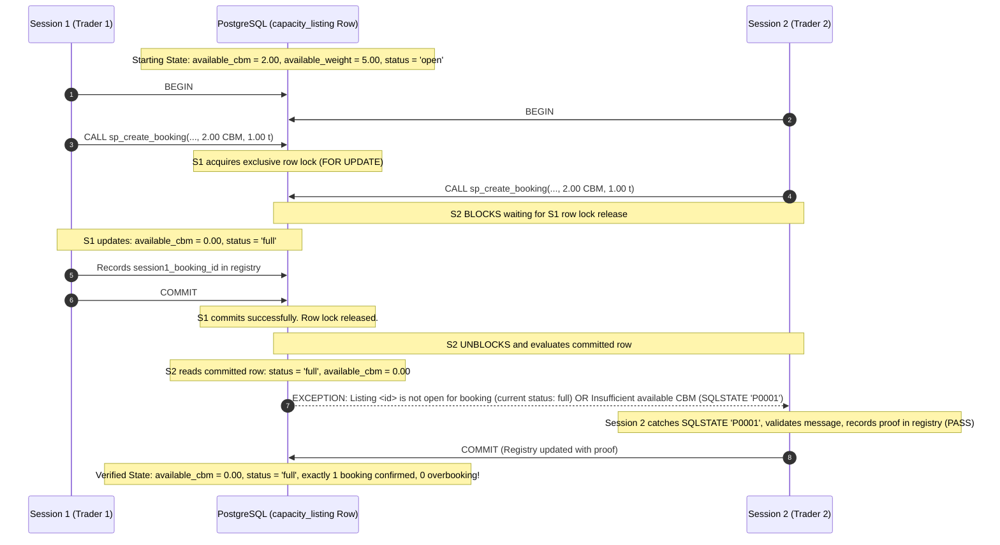

# Phase 6E: Concurrency Control, Transaction Safety, and Business Rules Mapping

## 1. Executive Summary

Phase 6E of the ShipSpace LCL Capacity Marketplace establishes database-level concurrency control, transaction isolation, and complete business-rule validation.

In a multi-user logistics marketplace, multiple freight traders may concurrently discover and attempt to book the last remaining capacity on an ocean container listing. Without database-level concurrency control, simultaneous read-modify-write operations produce race conditions leading to overbooking, phantom capacity, or negative stock.

ShipSpace prevents overbooking and state corruption directly within the PostgreSQL storage engine through:
1. **Pessimistic Row-Level Locking (`SELECT ... FOR UPDATE`)**: Exclusive locks serialize concurrent booking and cancellation operations at the listing and booking level.
2. **Atomic In-Transaction State Changes**: Capacity decrements, listing status updates (`open` $\rightarrow$ `full`), and price snapshots occur within the same ACID transaction boundary.
3. **Database Check Constraints as Ultimate Invariants**: Constraints like `ck_listing_available_cbm CHECK (available_cbm >= 0 AND available_cbm <= total_cbm)` physically forbid negative capacity under any circumstance.
4. **Lifecycle & Status Integrity**: Initial booking status must be `'confirmed'` (callers cannot bypass via direct insert); terminal statuses (`cancelled`, `completed`) cannot transition; cancellations restore exact capacity under lock and cannot be double-executed.

> [!NOTE]
> **Runtime Verification Summary (`shipspace_test_phase5`):**
> - **All 10 concurrency assertions passed (`PASS`).**
> - **Session 1** reserved `2.00 CBM` and `1.00` weight unit under exclusive `FOR UPDATE` row lock, reducing `available_cbm` to `0.00`, `available_weight` to `4.00`, and transitioning the listing status to `'full'`.
> - **Session 2** overlapped concurrently while Session 1 held its transaction open (`pre_lock` snapshot observed `status = open`, `available_cbm = 2.00`), waited **`2097.52 ms`** on the row lock, and was rejected with `SQLSTATE P0001` (`REJECTED_LISTING_FULL`).
> - Booking lifecycle status history was recorded, the test fixture was safely torn down, and seed data integrity was verified intact (`6` named providers, `5` sampled traders, `12` ports, and `45` listings), concluding with `PHASE 6E CONCURRENCY TEST: FULLY VERIFIED AND CLEANED UP`.

---

## 2. Business Rules Mapping (R1 – R9)

The table below maps each core business rule to its exact database-level implementation in schema constraints, triggers, and stored procedures:

| Rule ID | Business Rule | Database Enforcement Mechanism | Implemented In |
|---|---|---|---|
| **R1** | A booking can never exceed remaining CBM or remaining weight. | 1. Constraint: `ck_listing_available_cbm CHECK (available_cbm >= 0 AND available_cbm <= total_cbm)`<br>2. Constraint: `ck_listing_available_weight CHECK (available_weight >= 0 AND available_weight <= total_weight)`<br>3. Trigger: `fn_validate_and_reserve_booking()` raises exception if `NEW.booked_cbm > available_cbm` or `NEW.booked_weight > available_weight` under row lock.<br>4. Procedure: `sp_create_booking()` pre-checks capacity under row lock. | `sql/01_schema.sql`<br>`sql/05_functions_triggers.sql` |
| **R2** | Cargo type must be explicitly allowed on the listing. | 1. Foreign Key: `fk_booking_listing_cargo FOREIGN KEY (listing_id, cargo_type_id) REFERENCES listing_cargo (listing_id, cargo_type_id) ON DELETE RESTRICT`<br>2. Trigger: `fn_validate_and_reserve_booking()` verifies membership in `listing_cargo` and raises custom error if omitted. | `sql/01_schema.sql`<br>`sql/05_functions_triggers.sql` |
| **R3** | A booking must be made on or before the listing's cut-off date. | 1. Trigger: `fn_validate_and_reserve_booking()` compares `NEW.booking_time::date <= v_listing.cutoff_date` and raises exception if violated.<br>2. Procedure: `sp_create_booking()` enforces `CURRENT_DATE <= v_listing.cutoff_date`. | `sql/05_functions_triggers.sql` |
| **R4** | Cancelling a booking restores exact CBM and weight reserved; reopens listing if full. | 1. Trigger: `fn_restore_capacity_on_cancellation()` executes `AFTER UPDATE OF status ON booking`.<br>2. Locks `capacity_listing` row `FOR UPDATE`.<br>3. Restores exact amounts clamped by `LEAST(total_cbm, available_cbm + OLD.booked_cbm)`.<br>4. Reopens status from `'full'` to `'open'` if both CBM and weight > 0.<br>5. Terminal state validation in `fn_validate_booking_status_transition()` prevents duplicate restoration. | `sql/05_functions_triggers.sql` |
| **R5** | Concurrent bookings must never cause overbooking. | 1. Procedure: `sp_create_booking()` acquires `SELECT ... FROM capacity_listing WHERE id = p_listing_id FOR UPDATE;`<br>2. Trigger: `fn_validate_and_reserve_booking()` re-acquires `FOR UPDATE` on `INSERT ON booking`.<br>3. In `READ COMMITTED` isolation, concurrent sessions queue on the row lock; the second session re-reads committed capacity and aborts cleanly if exhausted. | `sql/05_functions_triggers.sql` |
| **R6** | Only open listings can be booked; a listing with no remaining capacity becomes full. | 1. Constraint: `ck_listing_status CHECK (status IN ('open', 'full', 'closed', 'cancelled'))`<br>2. Constraint: `ck_listing_status_capacity CHECK ((status <> 'open' OR (available_cbm > 0 AND available_weight > 0)) AND (status <> 'full' OR (available_cbm = 0 OR available_weight = 0)))`<br>3. Trigger: Automatically flips status to `'full'` when either CBM or weight reaches 0, or remains `'open'` otherwise. | `sql/01_schema.sql`<br>`sql/05_functions_triggers.sql` |
| **R7** | Quantities, prices positive; arrival after departure; total price snapshot immutable; initial status confirmed. | 1. Constraints on `capacity_listing`: `departure_date < arrival_date`, `cutoff_date <= departure_date`, prices and capacities > 0.<br>2. Trigger: `fn_validate_and_reserve_booking()` calculates frozen price `ROUND(GREATEST(cbm * rate, wt * rate, min_charge), 2)` and rejects initial statuses other than `'confirmed'`.<br>3. Trigger: `fn_validate_booking_status_transition()` raises exception if `NEW.total_price <> OLD.total_price` or if core reservation quantities are modified. | `sql/01_schema.sql`<br>`sql/05_functions_triggers.sql` |
| **R8** | Role and profile integrity. | Table-per-Subclass hierarchy (`user_account` $\rightarrow$ `provider`, `trader`, `admin`) with composite primary keys and role check constraints (`ck_provider_role`, `ck_trader_role`, `ck_admin_role`). | `sql/01_schema.sql` |
| **R9** | Bookings are never hard-deleted; audit history tracks all lifecycle states. | 1. Foreign keys use `ON DELETE RESTRICT` preventing accidental deletion.<br>2. Trigger: `fn_record_booking_status_history()` writes every transition (`confirmed`, `cancelled`, `completed`) to `booking_status_history` with actor ID and audit reason. | `sql/01_schema.sql`<br>`sql/05_functions_triggers.sql` |

---

## 3. Concurrency Control Mechanics

### 3.1 Lock Contention and Row Serialization Sequence



### 3.2 Double Cancellation & Restoration Prevention

When a booking is cancelled:
1. `sp_cancel_booking` acquires a row lock on the target booking:
   ```sql
   SELECT * INTO v_booking FROM booking WHERE id = p_booking_id FOR UPDATE;
   ```
2. If `v_booking.status = 'cancelled'`, it throws `Booking % has already been cancelled and cannot be cancelled again`.
3. If valid (`'confirmed'`), status transitions to `'cancelled'`.
4. Trigger `trg_restore_capacity_on_cancellation` fires, acquires an exclusive row lock on `capacity_listing`, and restores the reserved CBM and weight.
5. If two transactions attempt to cancel the exact same booking concurrently, Session 2 blocks on the booking row lock. Upon unblocking, it observes `status = 'cancelled'` and aborts cleanly. Double capacity restoration is physically impossible.

---

## 4. Reproducible Two-Session Concurrency Test Suite

To verify Phase 6E concurrency control against the test database `shipspace_test_phase5`, four modular, safe SQL scripts are provided in `sql/`:

1. [`sql/test_concurrency_setup.sql`](file:///c:/Users/Harshita/Documents/smartLCL/sql/test_concurrency_setup.sql):
   - Initializes dedicated, isolated test entities (ports `INCC1`/`SGCC2`, route, accounts `test.concurrency.*@shipspace.test`).
   - Registers target fixture in `shipspace.test_concurrency_fixture` with key `'PHASE_6E_CONCURRENCY'` and records explicit ownership flags (`created_*`).
   - Prepares listing with **exactly 2.00 CBM available**, 5.00 tonnes available, status `'open'`.
   - Strict Ambiguity & Ownership Guards: Validates every entity and relationship prior to any deletion (listing provider, route, cargo association, and internal consistency of `created_*` flags). Checks that no unrelated dependent rows exist before deleting created entities. If older registry records lack ownership flags, or if reserved entities exist without registry proof, setup halts before any DELETE with an explicit manual recovery notice. Post-verifies the final fixture in-transaction before commit.
2. [`sql/test_concurrency_session1.sql`](file:///c:/Users/Harshita/Documents/smartLCL/sql/test_concurrency_session1.sql):
   - Looks up registered fixture and verifies it is in its initial state (`status = 'open'`, `available_cbm = 2.00`).
   - Starts transaction, books 2.00 CBM under row lock, and polls `pg_locks` (`WHERE NOT granted AND pg_backend_pid() = ANY(pg_blocking_pids(pid))`) for up to 90 seconds until Session 2 is actively blocked on Session 1's lock.
   - Once Session 2 lock contention is confirmed, holds the lock for 2.0 more seconds so Session 2 records a measurable wait ($\ge 500\text{ ms}$), records `session1_booking_id` and `session1_saw_waiter = true` in the registry, and commits.
   - If Session 2 does not contend within 90 seconds, raises an exception and rolls back so non-overlapping runs are never accepted.
3. [`sql/test_concurrency_session2.sql`](file:///c:/Users/Harshita/Documents/smartLCL/sql/test_concurrency_session2.sql):
   - Captures the pre-lock MVCC snapshot (`status = open, available_cbm = 2.00` when started while Session 1 holds the uncommitted lock) and measures lock-wait duration.
   - Concurrently attempts identical 2.00 CBM booking on the same listing, blocking on the row lock until Session 1 commits.
   - Control Flow Isolation: Evaluates success/failure outside the catch block to prevent false passes.
   - Verifies SQLSTATE `'P0001'` and the genuine fixture-specific rejection error (`Listing <id> is not open for booking (current status: full)` or `Insufficient available CBM on listing <id>: ...`).
   - Persists outcome (`session2_result`, `session2_sqlstate`, `session2_error`) and overlap telemetry (`session2_pre_lock_status`, `session2_pre_lock_cbm`, `session2_lock_wait_ms`) in the registry, and fails explicitly if the sessions did not genuinely overlap (`pre_lock_status = 'open'`, `pre_lock_cbm = 2.00`, `lock_wait_ms >= 500`).
4. [`sql/test_concurrency_verify.sql`](file:///c:/Users/Harshita/Documents/smartLCL/sql/test_concurrency_verify.sql):
   - Evaluates 10 comprehensive assertions (registry uniqueness, 0.00 CBM, 4.00 wt, `'full'` status, single booking matching `session1_booking_id` with Session 1 trader ownership, confirmed status, 2.00/1.00 quantities, audit history, persisted Session 2 rejection proof with 0 bookings by Trader 2, and genuine two-session overlap & lock contention evidence).
   - Conditional Teardown: If ANY assertion fails, teardown is completely aborted to preserve data for diagnosis.
   - Verified Teardown: Validates all entity relationships, ownership flags, and unrelated dependencies prior to the first `DELETE`, removes only records where `created_*` is true, and checks named seed entities (6 providers, 5 sampled traders, all 12 reference seaports from `sql/02_seed_data.sql`, and 45 listings).

---

## 5. Local Execution Instructions (PowerShell)

All commands must be executed in PowerShell targeting `shipspace_test_phase5` (never `shipspace_db`):

### Step 1: Update Procedures & Triggers in `shipspace_test_phase5`
Run in PowerShell Terminal 1:
```powershell
& "C:\Program Files\PostgreSQL\18\bin\psql.exe" -U postgres -d shipspace_test_phase5 -v ON_ERROR_STOP=1 -f sql/05_functions_triggers.sql
```

### Step 2: Initialize (or Reset) Concurrency Test Fixture
Run in PowerShell Terminal 1:
```powershell
& "C:\Program Files\PostgreSQL\18\bin\psql.exe" -U postgres -d shipspace_test_phase5 -v ON_ERROR_STOP=1 -f sql/test_concurrency_setup.sql
```
*Expected Output: Validates and cleans up any retained fixture from a previous run, then confirms creation of a fresh fixture with `available_cbm = 2.00`, `available_weight = 5.00`, `status = 'open'`.*

### Step 3: Run the Concurrent Sessions (Two Terminals)
Open two separate PowerShell terminal windows side by side:

1. **In Terminal 1**, start Session 1 and enter your PostgreSQL password:
   ```powershell
   & "C:\Program Files\PostgreSQL\18\bin\psql.exe" -U postgres -d shipspace_test_phase5 -v ON_ERROR_STOP=1 -f sql/test_concurrency_session1.sql
   ```
   Wait until Terminal 1 prints:
   `[SESSION 1] Waiting (up to 90 seconds) for Session 2 to contend on the row lock...`
   `[SESSION 1] >>> SWITCH TO TERMINAL 2 NOW, RUN session2, AND ENTER PASSWORD <<<`
2. **In Terminal 2** (while Terminal 1 is waiting), start Session 2 and enter your PostgreSQL password:
   ```powershell
   & "C:\Program Files\PostgreSQL\18\bin\psql.exe" -U postgres -d shipspace_test_phase5 -v ON_ERROR_STOP=1 -f sql/test_concurrency_session2.sql
   ```

*Observed Behavior:*
- Terminal 2 connects, logs `Pre-lock visible snapshot on Listing ID <id>: status = open, available_cbm = 2.00`, and blocks on the row lock held by Session 1.
- Terminal 1 automatically detects Session 2 in `pg_locks` (`Lock contention confirmed after <s > s: Session 2 is actively blocked on our row lock!`), holds the lock for 2.0 seconds so Session 2 records a measurable wait ($\ge 2000\text{ ms}$), and commits.
- Terminal 2 immediately unblocks and reports:
  ```text
  [SESSION 2] EXPECTED TEST OUTCOME: Booking correctly rejected under lock.
  [SESSION 2] Pre-Lock Snapshot: status = open, available_cbm = 2.00 | Lock Wait: ~2000+ ms
  [SESSION 2] Recorded Outcome: REJECTED_LISTING_FULL (SQLSTATE P0001)
  [SESSION 2] Database Error Caught: Listing <id> is not open for booking (current status: full)
  [SESSION 2] CONCURRENCY OVERLAP & SAFETY VERIFIED (PASS): Overbooking prevented.
  [SESSION 2] TEST COMPLETED: CONCURRENCY PROTECTION CONFIRMED (PASS)
  ```

### Step 4: Verification and Safe Teardown
After both Terminal 1 and Terminal 2 finish, run in Terminal 1:
```powershell
& "C:\Program Files\PostgreSQL\18\bin\psql.exe" -U postgres -d shipspace_test_phase5 -v ON_ERROR_STOP=1 -f sql/test_concurrency_verify.sql
```

*Expected 10-Assertion Table:*
```text
  Assertion   |                       Test Requirement                       | Result |                     Details
--------------+--------------------------------------------------------------+--------+-------------------------------------------------
 ASSERTION 1  | Registry uniquely resolves to exactly one test fixture       | PASS   | Resolved Listing ID <id>
 ASSERTION 2  | Available CBM is exactly exhausted to 0.00 and never neg     | PASS   | available_cbm = 0.00 (>= 0 invariant holds)
 ASSERTION 3  | Available weight accurately decremented to 4.00 (5.00 - 1.00)| PASS   | available_weight = 4.00 (>= 0 invariant holds)
 ASSERTION 4  | Capacity listing status transitioned to "full"               | PASS   | status = full
 ASSERTION 5  | Loaded session1_booking_id from registry and matched single  | PASS   | Booking ID <id> matches session1_booking_id...
 ASSERTION 6  | Confirmed booking belongs strictly to Session 1 trader       | PASS   | trader_id = <t1_id> (matches Session 1 trader1_id)
 ASSERTION 7  | Booking confirmed with exact reserved quantities (2.00/1.00) | PASS   | status = confirmed, booked_cbm = 2.00, wt = 1.00
 ASSERTION 8  | Booking lifecycle status history recorded initial conf       | PASS   | Found 1 audit record(s) for booking <id>
 ASSERTION 9  | Session 2 rejection independently verified from recorded out | PASS   | Outcome: REJECTED_LISTING_FULL (SQLSTATE P0001)...
 ASSERTION 10 | Sessions overlapped concurrently under row lock              | PASS   | session1_saw_waiter = true, pre_lock = (open, 2.00 CBM)...
```
Followed by safe teardown and specific seed data verification:
`Seed integrity check: All named seed providers (6), traders (5 sampled), ports (12), and listings (45 total) verified intact.`
